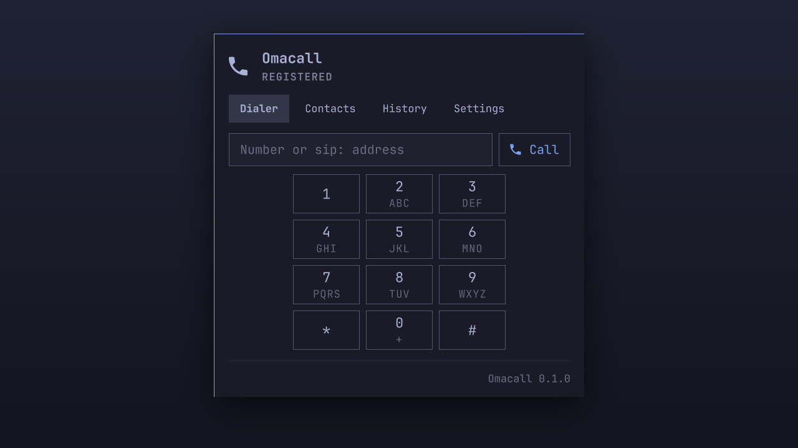
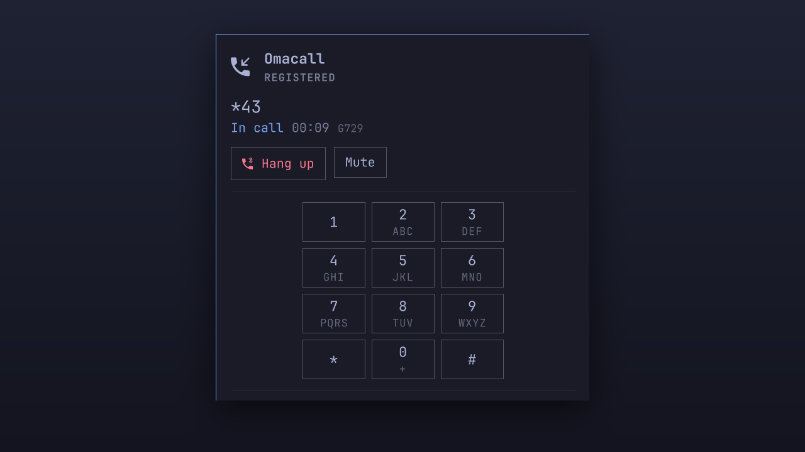
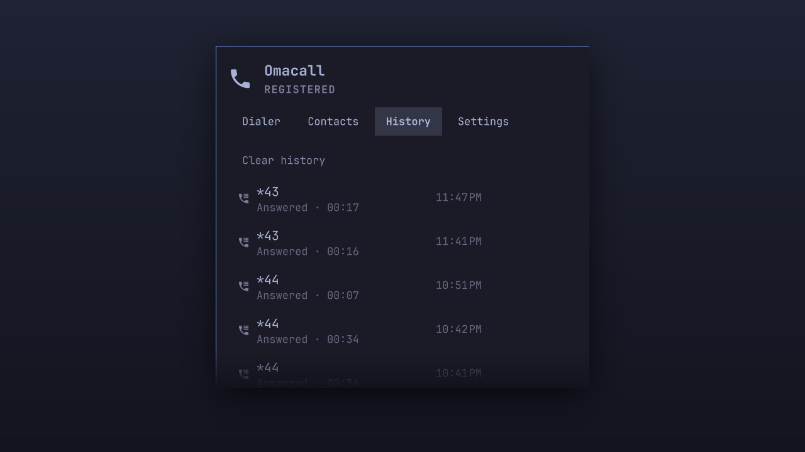
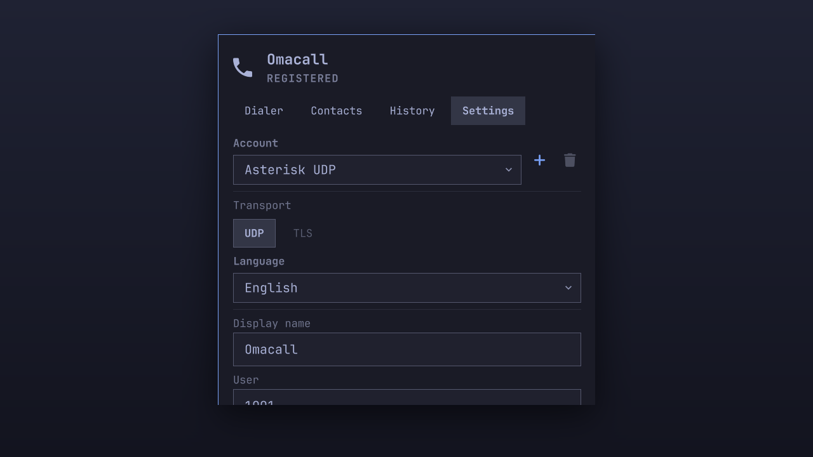

# Omacall

SIP softphone for [Omarchy](https://omarchy.org). One account, calls in and out,
DTMF, contacts and history, living in the Omarchy bar and following your theme.
UDP transport, G.729, Opus, G.711.



| In a call | Call history |
|---|---|
|  |  |

| Settings | |
|---|---|
|  | |

> **Status: in development.** Registering, calling out, DTMF, mute, contacts and
> history all work, from the panel and from the CLI. Incoming calls are written
> but not yet tested against a real PBX. Nothing here is released; the first
> release is v0.1.0.

## What it is

- Seven languages, picked in the panel or followed from `$LANG`
- Several SIP accounts configured, one registered at a time
- UDP or TLS, with the certificate actually verified

- `omacalld` — a small C daemon on top of [pjproject](https://github.com/pjsip/pjproject),
  with G.729 (via [bcg729](https://github.com/BelledonneCommunications/bcg729)), Opus and G.711
- `omacall` — a CLI for scripts and keybinds
- An Omarchy shell plugin (bar widget + panel) that talks to the daemon over a
  Unix socket

## Requirements

- Omarchy 4.x with the Quickshell shell
- Arch packages: `alsa-lib opus libsamplerate cjson util-linux-libs base-devel`
- AUR package: `bcg729`

## Install

```bash
omarchy plugin add https://github.com/f360c4/omacall.git --enable
```

The installer only clones files and validates the manifest — it never runs code
from the plugin. Omit `--enable` to review the code before enabling it with
`omarchy plugin enable f360c4.omacall`.

## Remove

```bash
omarchy plugin remove f360c4.omacall
```

## SIP over TLS

Set `account.transport` to `tls` in `~/.config/omacall/config.json`. The port
defaults to 5061. TLS covers the **signalling only** — the audio is still plain
RTP, because Omacall does not do SRTP. A PBX configured to require encrypted
media will refuse the call.

For a lab with a self-signed certificate, `tls.verify_server: false` accepts
it; the daemon logs a warning saying what that costs you.

## Scope

v1 is deliberately small: one account, no video, no transfer, no conference,
no recording, no SRTP.

## Security notes

The plugin runs unsandboxed inside `omarchy-shell`, like every Omarchy plugin.
The daemon runs as your user and listens only on a Unix socket in
`$XDG_RUNTIME_DIR`.

Omacall never touches your firewall. Omarchy ships `ufw` enabled with
`deny (incoming)`, and registering and placing calls work through it unchanged:
SIP and RTP go out from this machine, and the replies come back on connections
the firewall already knows about. Nothing here adds, removes or reads a firewall
rule — if you ever decide you want one, that stays your decision and your
command.

## Alternatives

[Simple SIP](https://github.com/17xande/omarchy-simple-sip) and
[Omasip](https://github.com/Vinicius-Galleti/oma.sip) are two other SIP plugins
for the Omarchy bar, both built on baresip. Omacall is for people who want
G.729, a DTMF pad, contacts and history together, and no Python or systemd unit
on their machine.

## License

GPL-3.0-or-later. The daemon links pjproject (GPL-2.0-or-later) statically and
bcg729 (GPL-3.0-or-later).
